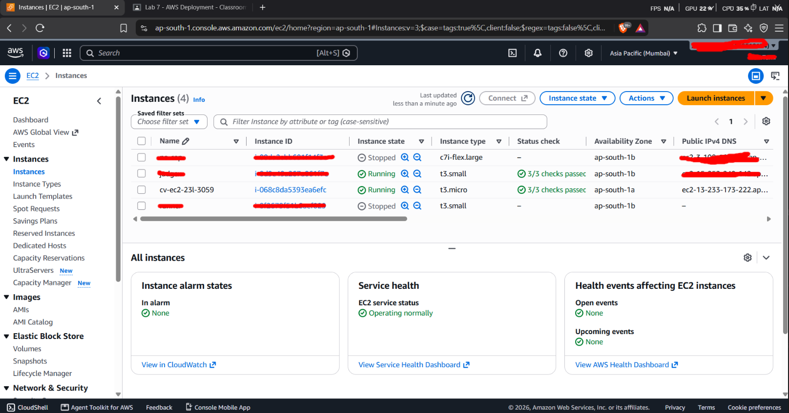
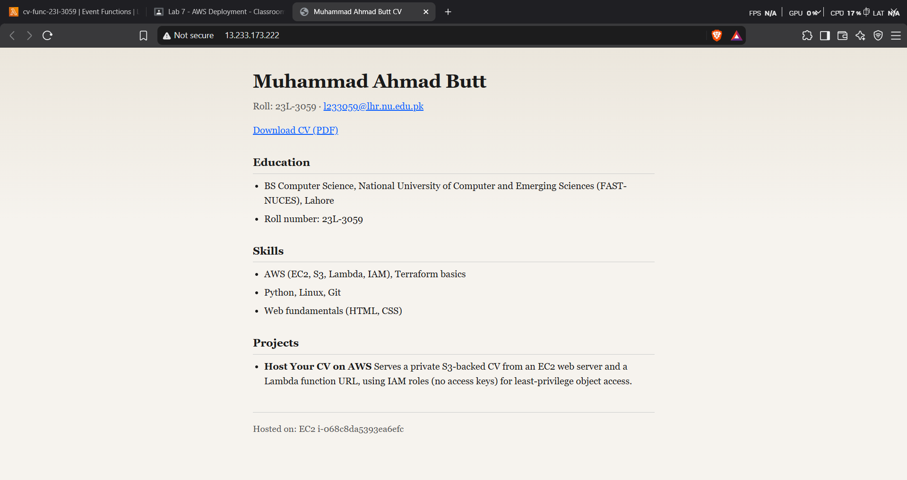
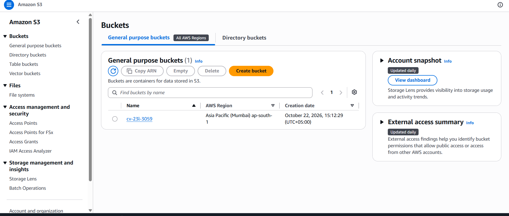
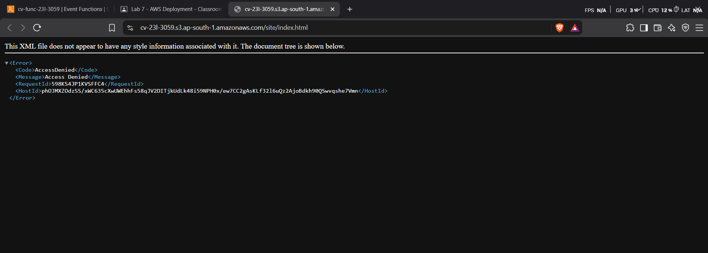

# Devops AWS LAB For Sir Duraiz 😘😘😘

Muhammad Ahmad Butt · `l233059@lhr.nu.edu.pk` · Region `ap-south-1`

**Live addresses (I destroyed cuz paise nahi itne -_- check images for proof):**
- EC2: http://13.233.173.222/
- Lambda: https://fs3jr7wllc5qz7udaozxm34twe0kocnh.lambda-url.ap-south-1.on.aws/

## Screenshots
### EC2 instance (`cv-ec2-23l-3059`)



### CV served from EC2 (Path A)



### Lambda function (`cv-func-23l-3059`)


### Private S3 bucket (`cv-23l-3059`)



### Direct S3 URL - Access Denied (C6)



## Resource names

| Resource | Name |
|----------|------|
| Bucket | `cv-23l-3059` |
| EC2 | `cv-ec2-23l-3059` |
| EC2 role | `cv-ec2-role-23l-3059` |
| Lambda | `cv-func-23l-3059` |
| Lambda role | `cv-lambda-role-23l-3059` |

Tags on bucket, instance, function, and both roles: `Owner=23L-3059`, `Course=cloud`.

## Deploy (Terraform)

Infrastructure is defined under `terraform/`

```bash
cd terraform
terraform init
terraform apply
```

Outputs include `ec2_url` and `lambda_url`.

After apply, wait ~2 minutes for user data, then:

```bash
./collect-evidence.sh cv-23l-3059 <ec2-public-ip> <lambda-function-url>
```

## Written answers

1. **Why roles instead of access keys?** Roles give temporary credentials via the instance/function identity service. Keys in user data would be visible to anyone who can read the launch template, console user data, or a cloned AMI, and would remain long-lived if leaked from a public repo.

2. **Direct S3 URL in a browser?** The visitor sees Access Denied. All four Block Public Access settings are on, and there is no bucket policy or ACL granting public read—so anonymous GetObject fails.

3. **Function URL public permission?** The permission allows `lambda:InvokeFunctionUrl` from principal `*` with auth type `NONE`, so anyone can call the URL. That is acceptable here because the function only exposes the intended CV content and cannot list or modify the bucket; the bucket itself must stay private so raw objects and versions are not world-readable.

4. **Compare costs / scale.** With no traffic you still pay for the running EC2 instance (and tiny S3 storage). Lambda costs near zero when idle (plus negligible log storage). If traffic grows ~100×, EC2 may need a larger type or more instances; Lambda scales automatically per request with pay-per-use.

5. **Delete the EC2 instance.** You lose Path A (the HTTP site and sync log on that host). You still have the S3 objects, IAM roles, Lambda path, and can launch a new instance that syncs the same bucket.

## Clean-up (after marking)

```bash
cd terraform && terraform destroy
```

Also confirm the log group, roles, bucket versions, and security group are gone in `ap-south-1`.
